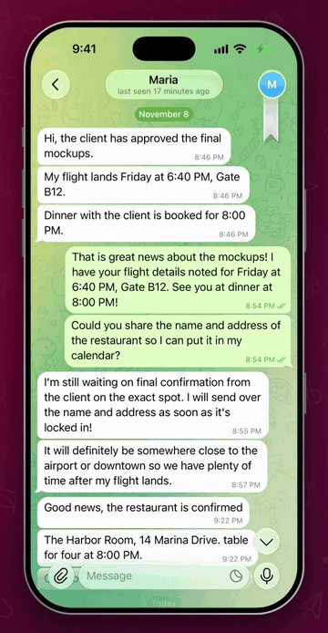
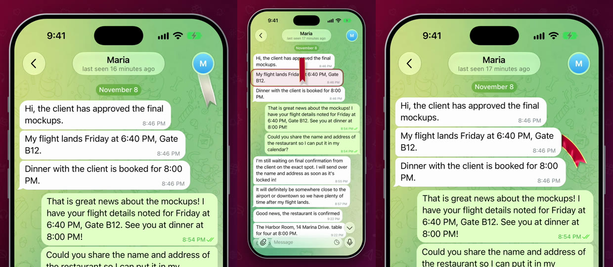

# Silk Bookmark

You stop halfway through a long chat, come back later and can't find your place. Pinning shows the
message to everyone in a group, and Saved Messages copies it away from where it was.

So every chat gets a small silk ribbon. It hangs at the top and swings when you scroll. Pull it onto any
message and it tucks behind the bubble, like a bookmark sticking out of a book. Scroll away and it flies
back to the top, turned crimson so you know a place is saved. Tap it and the chat glides right back.

This is a patch for the real Telegram for iOS, not a mock-up. The video was recorded from the app built
with this code, on a real account.

<p align="center">
  
</p>

▶︎ [Media/demo.mp4](Media/demo.mp4) is the full video (15 seconds).



## Where each part is

Everything sits at the same path it has inside Telegram-iOS, so `submodules/` can be copied straight
over a checkout.

### New files

| Part | File | What it does |
|---|---|---|
| The cloth | [`SilkCloth.swift`](submodules/TelegramUI/Components/Chat/SilkBookmark/Sources/SilkCloth.swift) | The physics of the ribbon: how it hangs, swings, trails your finger and settles beside a message. |
| The silk | [`SilkRenderer.swift`](submodules/TelegramUI/Components/Chat/SilkBookmark/Sources/SilkRenderer.swift) | Metal drawing: the satin shine, the gold edges, the shadow, and hiding the ribbon behind bubbles. |
| The behavior | [`SilkBookmarkView.swift`](submodules/TelegramUI/Components/Chat/SilkBookmark/Sources/SilkBookmarkView.swift) | Dragging, dropping, flying home, tapping, and when the ribbon wakes and sleeps. |
| Connecting it to a chat | [`ChatControllerSilkBookmark.swift`](submodules/TelegramUI/Sources/ChatControllerSilkBookmark.swift) | Finds the messages on screen, saves the bookmark, and scrolls back to it. |
| Bazel target | [`BUILD`](submodules/TelegramUI/Components/Chat/SilkBookmark/BUILD) | The `SilkBookmark` module. It builds with `-O` so the physics stays fast in debug builds. |

### Changes to Telegram's own files

One patch per part. They touch different files, so the order doesn't matter.

| Part | Patch | Files | What changes |
|---|---|---|---|
| Chat screen | [`01-chat-screen.patch`](patches/01-chat-screen.patch) | `ChatController.swift` | Adds the ribbon when a chat opens, including from a long-press preview, and keeps it laid out. |
| Scrolling | [`02-scroll-signal.patch`](patches/02-scroll-signal.patch) | `ChatControllerLoadDisplayNode.swift` | Tells the ribbon the list moved. |
| Pinned bar | [`03-pinned-bar.patch`](patches/03-pinned-bar.patch) | `ChatControllerNode.swift` | Reports where the pinned bar ends, so the ribbon hangs below it. |
| Bazel dependency | [`04-build-dependency.patch`](patches/04-build-dependency.patch) | `TelegramUI/BUILD` | Adds the new module to TelegramUI. |

## How it works

**The cloth.** The ribbon is a grid of 30 by 7 points joined by links that resist stretching and, more
weakly, bending. It's stepped 120 times a second. The notch in the tail is part of the mesh itself, so
its edges stay sharp.

**The swing.** The chat's scroll speed is measured from how far the messages actually moved, and turns
into wind on the ribbon. Faster scrolling, harder swing.

**Dragging.** A real cloth pulled downward would bunch up around your finger, so a soft spring keeps the
ribbon unfurled and leaning against the direction you move.

**The silk.** Satin shines in long bands that move as the cloth bends, so the shader lights it along the
direction of the threads. Gold edges are drawn from the position across the ribbon.

**Tucking behind the message.** The ribbon really sits above the chat, so the shader cuts away anything
inside a message bubble, with a soft dark line where it goes under. It follows a curve out into the empty
space beside the bubble. Because every nearby bubble is cut out, the ribbon can't cover any text.

**Staying still.** When nothing is moving the display link stops and nothing is drawn. While you scroll
past a settled ribbon, it just moves with the message without redrawing.

## Try it

This applies to Telegram-iOS at commit `24638bc69bd083981b178dd1e7f921eebbf7fc46`.

```sh
git clone --recursive https://github.com/TelegramMessenger/Telegram-iOS.git
cd Telegram-iOS
git checkout 24638bc69bd083981b178dd1e7f921eebbf7fc46
git submodule update --init --recursive

git clone https://github.com/Amithkodjj/telegram-silk-bookmark.git ../silk
cp -R ../silk/submodules/. submodules/
git apply ../silk/patches/*.patch
```

Then build it the way [Telegram's README](https://github.com/TelegramMessenger/Telegram-iOS#readme)
describes, with your own `api_id`. This repo compiles on its own against that commit, without the other
two patches.

## Numbers to play with

| Value | Default | Where | Meaning |
|---|---|---|---|
| `width`, `length` | 22, 86 pt | `SilkCloth` | Size of the ribbon |
| `notch` | 12 pt | `SilkCloth` | Depth of the cut in the tail |
| `rows`, `columns` | 30, 7 | `SilkCloth` | How fine the cloth is |
| `hangingGravity` | 1500 pt/s² | `SilkBookmarkView` | How heavy it feels |
| `theta1` | 0.18 rad | `drapeShape(for:)` | How straight the tail ends up beside a message |
| Grab distance | 19 pt | `point(inside:with:)` | How close a touch has to be |

## Notes and limits

* One ribbon per chat.
* The bookmark is saved on the device, per account and chat, so only you see it and it doesn't sync to
  your other devices.
* At the top of the chat the ribbon floats over whatever is under it, so you can always see and grab it.
* A press that starts on the ribbon moves the ribbon, not the list.
* With Reduce Motion on, it doesn't swing.
* It hides while you select messages or search.
* Tested on the iOS 27.2 Simulator (iPhone 18 Pro) in a debug build, in light and dark themes. It hasn't
  been run on a physical iPhone yet.

Built on [Telegram-iOS](https://github.com/TelegramMessenger/Telegram-iOS) and published to follow its
licence terms. The stretchy unread badge and paper plane forward are separate projects in their own
repositories.
